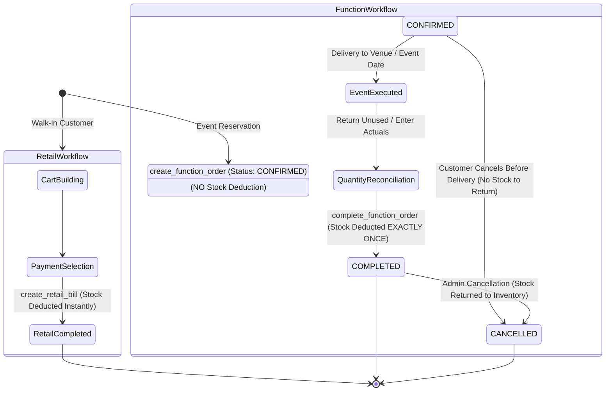
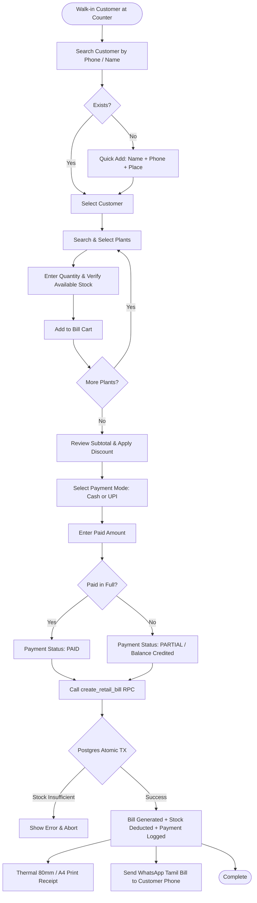
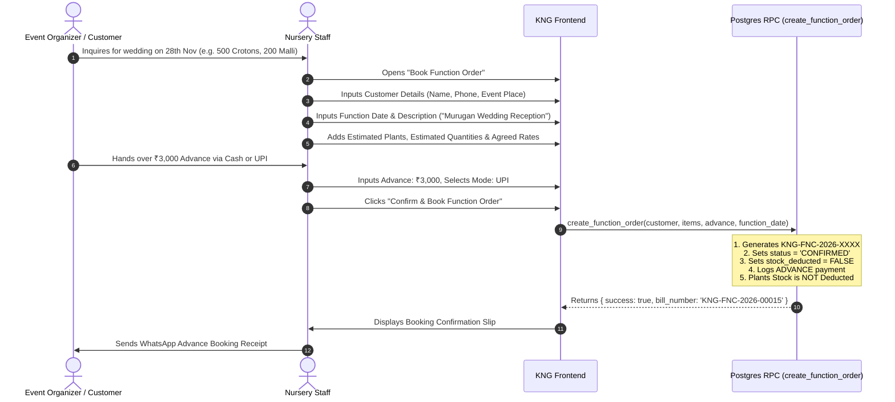
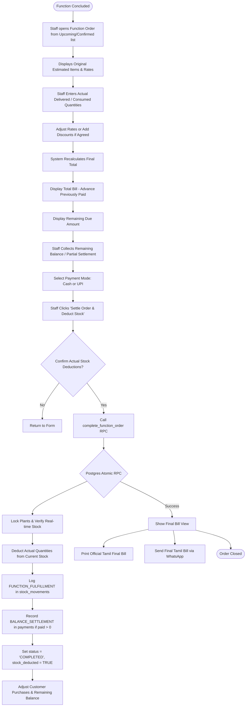
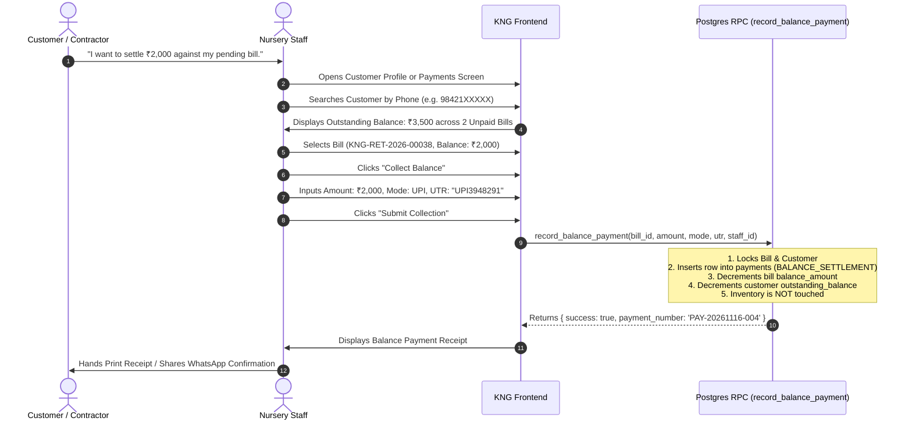

# Business Workflows & State Machines: Kalaiselvi Nursery Garden (KNG)

This document specifies the step-by-step business workflows, lifecycle state machines, transaction boundaries, and customer communication procedures for Kalaiselvi Nursery Garden.

---

## 1. Billing Lifecycle State Machine



---

## 2. Workflow 1: Retail Billing POS

### Business Context
Walk-in retail customers at the nursery counter purchasing potted plants, garden saplings, bags of manure, or pots. Speed of checkout and immediate inventory reduction are essential.

### Detailed Steps


### Critical Rules
1. **Atomic Stock Decrement**: The transaction must verify `current_stock >= requested_qty` for every line item with row-level locks (`FOR UPDATE`).
2. **Partial Payments**: If the customer pays ₹300 on a ₹500 bill, ₹200 is automatically added to their customer master `outstanding_balance` ledger.
3. **Receipt Generation**: Thermal 80mm format is generated instantly for counter printing.

---

## 3. Workflow 2: Function Order Booking (Advance Booking)

### Business Context
Customers planning weddings, temple festivals, school events, or corporate functions book plants days or weeks in advance. Quantities and varieties are estimated.



### Critical Rules
1. **Zero Stock Mutation**: The `plants.current_stock` table **MUST NOT** be modified during booking. The plants are still physically in the garden bed and need care until the event day.
2. **Advance Audit**: The advance payment is recorded in the `payments` table with `payment_type = 'ADVANCE'`, updating the customer's total paid amount.

---

## 4. Workflow 3: Function Order Completion (Post-Event Settlement)

### Business Context
After the event completes, unused plants or rental pots (if applicable) are returned, or additional plants supplied during the event are tallied. The actual delivered quantity is finalized.



### Critical Rules
1. **Exact Single Deduction**: The flag `bills.stock_deducted` transitions from `false` to `true`. If `stock_deducted` is already true, the procedure throws an exception.
2. **Variance Auditing**: Both `estimated_quantity` and `actual_quantity` remain preserved in `bill_items` for historical comparison and analytics.

---

## 5. Workflow 4: Advance & Partial Payments

1. **Advance on Function Booking**:
   - Recorded immediately under the `payments` table.
   - Tied directly to the `bill_id`.
   - Credited against the bill's `paid_amount`.
2. **Partial Payments at Retail Counter**:
   - Customer bill total is ₹1,200. Customer pays ₹500 in cash.
   - Bill is created with `paid_amount = 500.00`, `balance_amount = 700.00`, and `payment_status = 'PARTIAL'`.
   - Customer's master ledger `outstanding_balance` is credited by +₹700.00.

---

## 6. Workflow 5: Balance Collection (Debt Recovery)

### Business Context
A regular customer or landscape contractor visits the nursery to clear their pending balance from previous weeks or months.



---

## 7. Workflow 6: Stock Movements & Adjustments

### Scenario A: Stock IN (New Supply / Propagation)
- Staff selects plant, enters incoming quantity (e.g. `+100 pots`), selects source/supplier notes (e.g., `"Bangalore Lorry Batch"`).
- Increases `current_stock` by 100.
- Writes immutable record to `stock_movements` (`movement_type = 'STOCK_IN'`, delta = `+100`).

### Scenario B: Stock Adjustment (Admin Reconciliation)
- Weekly physical garden count reveals that Jasmine stock in system is 85, but physical count on ground is 78 (7 plants dried up or damaged by pests).
- Only an **Admin** can perform stock adjustments.
- Admin inputs physical count: `78`. System calculates variance: `-7`.
- Admin selects reason: `"Damaged / Died"`.
- Transaction sets `current_stock = 78` and logs `stock_movements` (`movement_type = 'DAMAGE_OUT'`, delta = `-7`).

---

## 8. Workflow 7: Bill Cancellation

1. **Retail Bill Cancellation (Admin Only)**:
   - Permitted only within an administrative grace period.
   - Admin enters mandatory cancellation reason.
   - Because stock was already deducted on retail sale, cancellation **automatically restores stock back to `plants.current_stock`** and logs `movement_type = 'BILL_CANCELLATION'`.
   - If payment was received, an offsetting refund entry or customer credit entry is recorded.
   - Bill status transitions to `CANCELLED`.
2. **Function Order Cancellation (Before Completion)**:
   - If the function is cancelled before the event date, `stock_deducted` is still `false`.
   - Therefore, **no inventory adjustment is required**.
   - Admin manages advance refund policy (refund cash or retain advance as cancellation fee), and sets status to `CANCELLED`.

---

## 9. Customer Bill Design & WhatsApp Message Generation

### 9.1 Specification Reference Format
Every generated bill and WhatsApp message adheres strictly to the business's official reference template:

```
🌱 KALAISELVI NURSERY GARDEN

📍 Mailam Road, Kutteripattu – 604304

━━━━━━━━━━━━━━

👤 Customer Name: [Customer Name]
📍 Place: [Place]
📅 Date: [Date]

🌿 Order Details
- Plant Quantity: [Quantity]
- Rate: ₹[Rate]
- Total Amount: ₹[Total]

💰 Payment Details
- Advance Paid: ₹[Advance]
- Balance Amount: ₹[Balance]

━━━━━━━━━━━━━━

🧾 Billed By: [Staff Name]
📞 [Staff Phone]

🙏 Thank you for choosing Kalaiselvi Nursery Garden! 🌱
```

### 9.2 WhatsApp URI Encoding Architecture
The application formats this data and generates a direct link:
```typescript
export function generateWhatsAppBillUrl(params: {
  customerPhone: string;
  customerName: string;
  place: string;
  date: string;
  totalQuantity: number;
  rateDescription: string; // e.g. "40.00" or "Multiple"
  totalAmount: number;
  advancePaid: number;
  balanceAmount: number;
  staffName: string;
  staffPhone: string;
}): string {
  // Format phone to E.164 without plus sign for WhatsApp wa.me
  const cleanPhone = params.customerPhone.replace(/\D/g, '');
  const formattedPhone = cleanPhone.startsWith('91') ? cleanPhone : `91${cleanPhone}`;

  const message = `🌱 *KALAISELVI NURSERY GARDEN*

📍 Mailam Road, Kutteripattu – 604304

━━━━━━━━━━━━━━

👤 *Customer Name:* ${params.customerName}
📍 *Place:* ${params.place}
📅 *Date:* ${params.date}

🌿 *Order Details*
- Plant Quantity: ${params.totalQuantity}
- Rate: ₹${params.rateDescription}
- Total Amount: ₹${params.totalAmount.toFixed(2)}

💰 *Payment Details*
- Advance Paid: ₹${params.advancePaid.toFixed(2)}
- Balance Amount: ₹${params.balanceAmount.toFixed(2)}

━━━━━━━━━━━━━━

🧾 *Billed By:* ${params.staffName}
📞 ${params.staffPhone}

🙏 *Thank you for choosing Kalaiselvi Nursery Garden!* 🌱`;

  return `https://wa.me/${formattedPhone}?text=${encodeURIComponent(message)}`;
}
```
