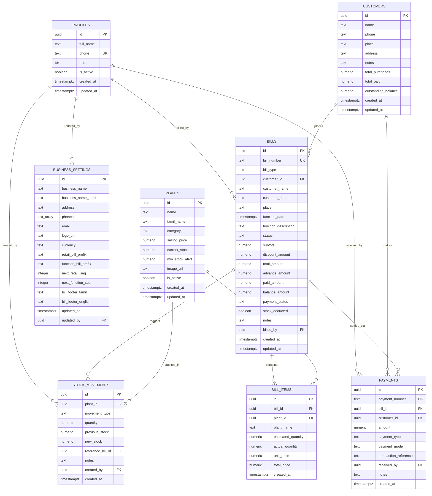

# Entity-Relationship Diagram & Data Dictionary: Kalaiselvi Nursery Garden (KNG)

## 1. Entity-Relationship Diagram (ERD)

---

## 2. Cardinality & Referential Integrity Matrix

| Parent Table | Child Table | Relationship | On Delete | Business Rationale |
| :--- | :--- | :--- | :--- | :--- |
| `auth.users` | `profiles` | 1-to-1 | `CASCADE` | Deleting a Supabase auth account removes its profile. |
| `profiles` | `bills` | 1-to-Many | `RESTRICT` | Bill history must be permanently attributable to the billing staff member. |
| `profiles` | `payments` | 1-to-Many | `RESTRICT` | Financial receipts must permanently identify the staff member who collected money. |
| `profiles` | `stock_movements` | 1-to-Many | `RESTRICT` | Stock adjustments must identify who performed them. |
| `customers` | `bills` | 1-to-Many | `RESTRICT` | A customer with previous order history cannot be deleted without losing legal financial audit data. |
| `customers` | `payments` | 1-to-Many | `RESTRICT` | Customer payment history cannot be orphaned. |
| `bills` | `bill_items` | 1-to-Many | `CASCADE` | Items belong directly to the bill container. |
| `bills` | `payments` | 1-to-Many | `RESTRICT` | Bills cannot be deleted if payment records exist. |
| `bills` | `stock_movements` | 1-to-Many | `SET NULL` | Stock movements preserve audit logs even if a bill record is archived. |
| `plants` | `bill_items` | 1-to-Many | `RESTRICT` | Plants cannot be deleted if referenced in previous invoices (soft-delete via `is_active = false` instead). |
| `plants` | `stock_movements`| 1-to-Many | `RESTRICT` | Inventory audit trails require referential plant integrity. |

---

## 3. Data Dictionary

### 3.1 `profiles`
Stores operational staff data extending Supabase `auth.users`.

| Column | Type | Constraints | Description |
| :--- | :--- | :--- | :--- |
| `id` | `UUID` | PK, FK `auth.users(id)` | User ID mapped directly to Supabase authentication UID. |
| `full_name` | `TEXT` | NOT NULL | Staff member's display name printed on customer bills. |
| `phone` | `TEXT` | NOT NULL, UNIQUE | Staff phone number used for login and customer contact. |
| `role` | `TEXT` | NOT NULL, CHECK in ('admin', 'staff') | Role determining administrative and billing access. |
| `is_active` | `BOOLEAN` | NOT NULL, DEFAULT true | Flag allowing instant deactivation of former staff. |
| `created_at` | `TIMESTAMPTZ` | NOT NULL, DEFAULT now() | Account creation timestamp. |
| `updated_at` | `TIMESTAMPTZ` | NOT NULL, DEFAULT now() | Last update timestamp. |

---

### 3.2 `business_settings`
Singleton table holding store details, branding, and billing numbering counters.

| Column | Type | Constraints | Description |
| :--- | :--- | :--- | :--- |
| `id` | `UUID` | PK | Primary key identifier. |
| `business_name` | `TEXT` | NOT NULL | Default: 'Kalaiselvi Nursery Garden'. |
| `business_name_tamil`| `TEXT` | NOT NULL | Default: 'கலைச்செல்வி நர்சரி கார்டன்'. |
| `address` | `TEXT` | NOT NULL | Physical location in Kutteripattu. |
| `phones` | `TEXT[]` | NOT NULL | Array of official contact phone numbers. |
| `email` | `TEXT` | NULLABLE | Business contact email. |
| `logo_url` | `TEXT` | NULLABLE | Supabase Storage URL for the official nursery logo. |
| `currency` | `TEXT` | NOT NULL, DEFAULT 'INR'| Base operating currency. |
| `retail_bill_prefix` | `TEXT` | NOT NULL | Prefix for retail receipts (e.g. 'KNG-RET'). |
| `function_bill_prefix`| `TEXT` | NOT NULL | Prefix for function orders (e.g. 'KNG-FNC'). |
| `next_retail_seq` | `INTEGER` | NOT NULL, DEFAULT 1 | Atomic sequential counter for retail bills. |
| `next_function_seq`| `INTEGER` | NOT NULL, DEFAULT 1 | Atomic sequential counter for function orders. |
| `bill_footer_tamil` | `TEXT` | NOT NULL | Tamil message printed on bill bottom and WhatsApp. |
| `bill_footer_english`| `TEXT` | NOT NULL | English greeting message. |
| `updated_at` | `TIMESTAMPTZ` | NOT NULL, DEFAULT now() | Settings modification timestamp. |
| `updated_by` | `UUID` | FK `profiles(id)` | Admin who modified the business parameters. |

---

### 3.3 `customers`
Customer master directory tracking purchase volume and live balance receivables.

| Column | Type | Constraints | Description |
| :--- | :--- | :--- | :--- |
| `id` | `UUID` | PK | Unique customer identifier. |
| `name` | `TEXT` | NOT NULL | Customer full name. |
| `phone` | `TEXT` | NOT NULL | Mobile number used for WhatsApp billing and search lookup. |
| `place` | `TEXT` | NOT NULL | Town, village, or area (e.g., Kutteripattu, Tindivanam). |
| `address` | `TEXT` | NULLABLE | Full street address if applicable. |
| `notes` | `TEXT` | NULLABLE | Internal staff notes (e.g., preferred plant varieties). |
| `total_purchases` | `NUMERIC(12,2)` | >= 0, DEFAULT 0.00 | Lifetime invoiced value for this customer. |
| `total_paid` | `NUMERIC(12,2)` | >= 0, DEFAULT 0.00 | Lifetime payments collected from this customer. |
| `outstanding_balance`| `NUMERIC(12,2)`| DEFAULT 0.00 | Current pending dues (`total_purchases - total_paid`). |
| `created_at` | `TIMESTAMPTZ` | NOT NULL, DEFAULT now() | Registration timestamp. |
| `updated_at` | `TIMESTAMPTZ` | NOT NULL, DEFAULT now() | Modification timestamp. |

---

### 3.4 `plants`
Catalog of plants, shrubs, trees, pots, and nursery supplies.

| Column | Type | Constraints | Description |
| :--- | :--- | :--- | :--- |
| `id` | `UUID` | PK | Unique plant identifier. |
| `name` | `TEXT` | NOT NULL | Common English / Botanical name (e.g. 'Jasmine / Malli'). |
| `tamil_name` | `TEXT` | NULLABLE | Tamil name (e.g. 'மல்லிகை'). |
| `category` | `TEXT` | NOT NULL, CHECK list | Category (Flowering, Fruit, Timber, Indoor, etc.). |
| `selling_price` | `NUMERIC(12,2)` | >= 0 | Standard counter selling rate per unit in INR. |
| `current_stock` | `NUMERIC(10,2)` | >= 0, DEFAULT 0.00 | Real-time available quantity in nursery. |
| `min_stock_alert`| `NUMERIC(10,2)` | >= 0, DEFAULT 10.00 | Threshold below which low-stock badge is triggered. |
| `image_url` | `TEXT` | NULLABLE | Optional photo preview of plant. |
| `is_active` | `BOOLEAN` | NOT NULL, DEFAULT true | Soft-delete status; inactive plants are hidden from POS. |
| `created_at` | `TIMESTAMPTZ` | NOT NULL, DEFAULT now() | Catalog entry timestamp. |
| `updated_at` | `TIMESTAMPTZ` | NOT NULL, DEFAULT now() | Stock/Price modification timestamp. |

---

### 3.5 `bills`
Central order and invoice table for both Retail Sales and Function Orders.

| Column | Type | Constraints | Description |
| :--- | :--- | :--- | :--- |
| `id` | `UUID` | PK | Unique bill record identifier. |
| `bill_number` | `TEXT` | NOT NULL, UNIQUE | Generated sequential invoice code (e.g., 'KNG-RET-2026-00012'). |
| `bill_type` | `TEXT` | NOT NULL, 'RETAIL' or 'FUNCTION' | Differentiates fast retail checkout vs deferred event order. |
| `customer_id` | `UUID` | NOT NULL, FK `customers` | Reference to customer master. |
| `customer_name` | `TEXT` | NOT NULL | Snapshot of customer name at billing time. |
| `customer_phone`| `TEXT` | NOT NULL | Snapshot of WhatsApp contact at billing time. |
| `place` | `TEXT` | NOT NULL | Snapshot of delivery / event location. |
| `function_date` | `TIMESTAMPTZ`| NULLABLE | Scheduled date of function (for FUNCTION orders). |
| `function_description`| `TEXT` | NULLABLE | Description of event (e.g., 'Temple Kumbabishegam / Wedding'). |
| `status` | `TEXT` | NOT NULL, CHECK | Status: 'OPEN', 'CONFIRMED', 'COMPLETED', 'CANCELLED'. |
| `subtotal` | `NUMERIC(12,2)` | >= 0 | Sum of line item prices before discount. |
| `discount_amount`| `NUMERIC(12,2)`| >= 0 | Overall bill discount granted in INR. |
| `total_amount` | `NUMERIC(12,2)` | >= 0 | Net invoice total (`subtotal - discount_amount`). |
| `advance_amount`| `NUMERIC(12,2)` | >= 0 | Advance paid at booking time (for Function Orders). |
| `paid_amount` | `NUMERIC(12,2)` | >= 0 | Total cumulative payments collected against this bill. |
| `balance_amount`| `NUMERIC(12,2)`| >= 0 | Remaining unpaid balance (`total_amount - paid_amount`). |
| `payment_status`| `TEXT` | 'UNPAID', 'PARTIAL', 'PAID'| Payment status indicator. |
| `stock_deducted`| `BOOLEAN` | NOT NULL, DEFAULT false | Flag ensuring inventory is deducted **exactly once**. |
| `notes` | `TEXT` | NULLABLE | Remarks or delivery instructions. |
| `billed_by` | `UUID` | NOT NULL, FK `profiles` | Staff user who generated or completed the bill. |
| `created_at` | `TIMESTAMPTZ` | NOT NULL, DEFAULT now() | Order creation timestamp. |
| `updated_at` | `TIMESTAMPTZ` | NOT NULL, DEFAULT now() | Last update timestamp. |

---

### 3.6 `bill_items`
Individual line items attached to a bill.

| Column | Type | Constraints | Description |
| :--- | :--- | :--- | :--- |
| `id` | `UUID` | PK | Unique item record identifier. |
| `bill_id` | `UUID` | NOT NULL, FK `bills` ON CASCADE | Associated invoice header. |
| `plant_id` | `UUID` | NOT NULL, FK `plants` | Catalog plant referenced. |
| `plant_name` | `TEXT` | NOT NULL | Plant name snapshot. |
| `estimated_quantity`| `NUMERIC(10,2)`| >= 0 | Initial quantity quoted during function booking. |
| `actual_quantity`| `NUMERIC(10,2)`| >= 0 | Final delivered quantity deducted from inventory. |
| `unit_price` | `NUMERIC(12,2)` | >= 0 | Agreed selling rate per unit in INR. |
| `total_price` | `NUMERIC(12,2)` | >= 0 | Line total (`actual_quantity * unit_price` or estimated). |
| `created_at` | `TIMESTAMPTZ` | NOT NULL, DEFAULT now() | Record insertion timestamp. |

---

### 3.7 `payments`
Immutable audit log of all financial inflows (advances, counter payments, balance settlements).

| Column | Type | Constraints | Description |
| :--- | :--- | :--- | :--- |
| `id` | `UUID` | PK | Unique payment identifier. |
| `payment_number`| `TEXT` | NOT NULL, UNIQUE | Receipt number (e.g. 'PAY-20261116-1234'). |
| `bill_id` | `UUID` | NOT NULL, FK `bills` | Target bill against which payment was credited. |
| `customer_id` | `UUID` | NOT NULL, FK `customers` | Customer who paid. |
| `amount` | `NUMERIC(12,2)` | > 0 | Amount collected in INR. |
| `payment_type` | `TEXT` | CHECK in ('RETAIL_PAYMENT', 'ADVANCE', 'BALANCE_SETTLEMENT') | Context of the collection. |
| `payment_mode` | `TEXT` | CHECK in ('CASH', 'UPI') | Payment channel used. |
| `transaction_reference`| `TEXT` | NULLABLE | UPI UTR / reference number (if applicable). |
| `received_by` | `UUID` | NOT NULL, FK `profiles` | Staff member who received the cash/verified UPI. |
| `notes` | `TEXT` | NULLABLE | Transaction remarks. |
| `created_at` | `TIMESTAMPTZ` | NOT NULL, DEFAULT now() | Timestamp money was collected. |

---

### 3.8 `stock_movements`
Immutable audit log of all inventory movements.

| Column | Type | Constraints | Description |
| :--- | :--- | :--- | :--- |
| `id` | `UUID` | PK | Unique movement ledger ID. |
| `plant_id` | `UUID` | NOT NULL, FK `plants` | Plant whose inventory changed. |
| `movement_type`| `TEXT` | CHECK list | Context ('RETAIL_SALE', 'FUNCTION_FULFILLMENT', 'STOCK_IN', etc.). |
| `quantity` | `NUMERIC(10,2)` | NOT NULL | Signed delta (+ for intake, - for sale/damage). |
| `previous_stock`| `NUMERIC(10,2)`| >= 0 | Stock balance immediately prior to this transaction. |
| `new_stock` | `NUMERIC(10,2)` | >= 0 | Stock balance immediately after this transaction. |
| `reference_bill_id`| `UUID` | NULLABLE, FK `bills` | Associated invoice (if movement triggered by sale). |
| `notes` | `TEXT` | NULLABLE | Reason for adjustment or supplier delivery details. |
| `created_by` | `UUID` | NOT NULL, FK `profiles` | Staff / Admin who executed the movement. |
| `created_at` | `TIMESTAMPTZ` | NOT NULL, DEFAULT now() | Movement execution timestamp. |
