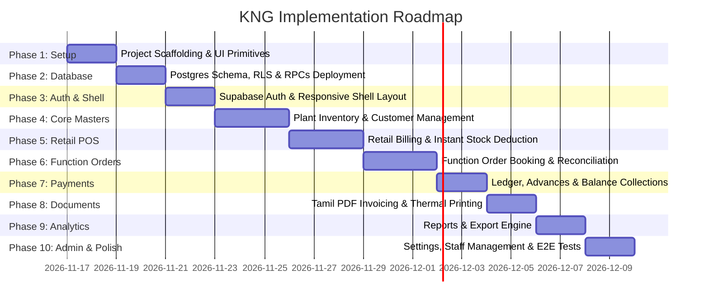

# Implementation Roadmap & Task Breakdown: Kalaiselvi Nursery Garden (KNG)

This document provides a structured, phased implementation roadmap for developing the Kalaiselvi Nursery Garden web application. Tasks are designed to be independent, sequential, and testable by an AI coding agent or development team.

---

## 1. Roadmap Overview & Timeline

---

## 2. Detailed Task Breakdown

### Phase 1: Project Scaffolding & Tooling
- **Task 1.1**: Initialize Vite React TypeScript project with Tailwind CSS and PostCSS.
  - *Dependencies*: None.
  - *Deliverables*: Clean `package.json`, `vite.config.ts`, `tailwind.config.js`, `tsconfig.json`.
  - *Acceptance Criteria*: `npm.cmd run build` passes with zero errors; Tailwind utility classes compile correctly.
- **Task 1.2**: Install and configure `shadcn/ui` and core dependencies.
  - *Dependencies*: Task 1.1.
  - *Deliverables*: `components.json`, `@/lib/utils.ts`, installed primitives (`Button`, `Input`, `Dialog`, `Select`, `DropdownMenu`, `Card`, `Badge`, `Tabs`, `Table`, `Toast`).
  - *Acceptance Criteria*: Demo button with custom Forest Green theme renders properly.
- **Task 1.3**: Configure client router, TanStack Query, and Supabase client.
  - *Dependencies*: Task 1.2.
  - *Deliverables*: `src/lib/supabaseClient.ts`, `src/App.tsx` with `QueryClientProvider` and `BrowserRouter`.
  - *Acceptance Criteria*: App renders base shell with routing capability.

---

### Phase 2: Database Schema & Migration Deployment
- **Task 2.1**: Deploy PostgreSQL tables (`profiles`, `business_settings`, `customers`, `plants`, `bills`, `bill_items`, `payments`, `stock_movements`).
  - *Dependencies*: Task 1.3.
  - *Deliverables*: Supabase SQL migration script.
  - *Acceptance Criteria*: All tables, indexes, and constraints exist with correct numeric precision.
- **Task 2.2**: Deploy atomic stored procedures (RPCs) and triggers.
  - *Dependencies*: Task 2.1.
  - *Deliverables*: `generate_bill_number`, `create_retail_bill`, `create_function_order`, `complete_function_order`, `record_balance_payment`.
  - *Acceptance Criteria*: Running test RPC invocations succeeds and rollback occurs on insufficient stock.
- **Task 2.3**: Configure Row Level Security (RLS) policies and test seed data.
  - *Dependencies*: Task 2.2.
  - *Deliverables*: Applied RLS policies; seed script with nursery settings and sample plant categories.
  - *Acceptance Criteria*: Unauthenticated requests are blocked; authenticated staff can read catalog.

---

### Phase 3: Auth & Application Shell
- **Task 3.1**: Build login screen and Supabase Auth session provider.
  - *Dependencies*: Phase 2.
  - *Deliverables*: `src/features/auth/components/LoginForm.tsx`, `useAuth` hook.
  - *Acceptance Criteria*: Staff can log in with phone/email and password; session persists in browser storage.
- **Task 3.2**: Construct responsive layout shell (Desktop Sidebar + Mobile Bottom Navigation).
  - *Dependencies*: Task 3.1.
  - *Deliverables*: `AppLayout.tsx`, `DesktopSidebar.tsx`, `MobileBottomNav.tsx`, `AppHeader.tsx`.
  - *Acceptance Criteria*: On desktop (>1024px) sidebar is visible; on mobile (<1024px) 5-tab bottom navigation is pinned to bottom with 48px touch targets.

---

### Phase 4: Core Masters (Inventory & Customers)
- **Task 4.1**: Build Plant Inventory catalog management.
  - *Dependencies*: Phase 3.
  - *Deliverables*: `PlantListTable.tsx`, `PlantFormModal.tsx`, Category filtering, Low stock indicators.
  - *Acceptance Criteria*: Plants can be added, edited, searched, and filtered by category; low stock plants show amber badge.
- **Task 4.2**: Build Stock IN and Stock Adjustment modals.
  - *Dependencies*: Task 4.1.
  - *Deliverables*: `StockInModal.tsx`, `StockAdjustmentModal.tsx`, `StockMovementHistory.tsx`.
  - *Acceptance Criteria*: Stock IN increments `current_stock` and appends movement log; Admin adjustment updates stock with mandatory reason.
- **Task 4.3**: Build Customer directory and profile ledger.
  - *Dependencies*: Phase 3.
  - *Deliverables*: `CustomerListTable.tsx`, `CustomerFormModal.tsx`, `CustomerLedgerHistory.tsx`.
  - *Acceptance Criteria*: Fast customer search by mobile number; customer view displays order history and live outstanding balance.

---

### Phase 5: Retail Billing POS & WhatsApp Engine
- **Task 5.1**: Build Retail Billing POS screen.
  - *Dependencies*: Phase 4.
  - *Deliverables*: `RetailBillingForm.tsx`, Plant quick-search combobox, Cart table, Discount and Grand Total calculator.
  - *Acceptance Criteria*: Keyboard-friendly; line totals update in real-time; quantity controls cannot exceed available stock.
- **Task 5.2**: Integrate `create_retail_bill` RPC and transaction handling.
  - *Dependencies*: Task 5.1.
  - *Deliverables*: `billingService.ts`, mutation hooks, error alerts for stock collisions.
  - *Acceptance Criteria*: Submitting bill atomically decrements plant stock, creates bill items, logs payment, and generates sequential `KNG-RET` number.
- **Task 5.3**: Build WhatsApp sharing module.
  - *Dependencies*: Task 5.2.
  - *Deliverables*: `src/lib/whatsappHelper.ts`, `WhatsAppShareModal.tsx`.
  - *Acceptance Criteria*: Generates valid `https://wa.me/91...` deep link matching the exact customer bill reference template.

---

### Phase 6: Function Order Lifecycle
- **Task 6.1**: Build Function Order booking screen.
  - *Dependencies*: Phase 4.
  - *Deliverables*: `FunctionBookingForm.tsx`, Event date/time selector, Estimated plant items table, Advance payment entry.
  - *Acceptance Criteria*: Calls `create_function_order`; **verifies zero stock is deducted**; records advance payment and outputs booking slip.
- **Task 6.2**: Build Function Order list and tracking view.
  - *Dependencies*: Task 6.1.
  - *Deliverables*: Function orders view with status filter (`OPEN`, `CONFIRMED`, `COMPLETED`, `CANCELLED`).
  - *Acceptance Criteria*: Displays function date countdown, customer contact, advance received, and pending balance.
- **Task 6.3**: Build Function Order reconciliation & completion modal.
  - *Dependencies*: Task 6.2.
  - *Deliverables*: `FunctionCompletionModal.tsx`, Estimated vs Actual comparison table, Final rate adjustments, Settlement payment entry.
  - *Acceptance Criteria*: Calls `complete_function_order`; verifies stock availability; deducts actual quantity **exactly once**; marks order `COMPLETED`.

---

### Phase 7: Payments & Ledger Module
- **Task 7.1**: Build Balance Collection modal and transaction handler.
  - *Dependencies*: Phase 5 & 6.
  - *Deliverables*: `BalanceCollectionModal.tsx`, `paymentService.ts`.
  - *Acceptance Criteria*: Staff can select an unpaid bill, collect Cash/UPI, call `record_balance_payment`, and decrement customer debt.
- **Task 7.2**: Build Payments history and receipts list.
  - *Dependencies*: Task 7.1.
  - *Deliverables*: `PaymentListTable.tsx`, `PaymentReceiptModal.tsx`.
  - *Acceptance Criteria*: Searchable list of all payment transactions with receipt numbers, mode, and staff name.

---

### Phase 8: Document Generation (Tamil PDF & Print)
- **Task 8.1**: Implement Tamil font loading and HTML-to-Canvas rasterizer.
  - *Dependencies*: Task 5.3.
  - *Deliverables*: `src/lib/pdfGenerator.ts` using `jsPDF` + `html2canvas` + Google Noto Sans Tamil.
  - *Acceptance Criteria*: Tamil text renders with 100% correct ligatures and no garbled glyphs.
- **Task 8.2**: Create Thermal (80mm) POS and A4/A5 Printable Receipt layouts.
  - *Dependencies*: Task 8.1.
  - *Deliverables*: `BillReceiptPreview.tsx` with dedicated `@media print` CSS rules.
  - *Acceptance Criteria*: One-click print outputs clean receipt without UI headers or sidebar.

---

### Phase 9: Reports & Analytics Dashboard
- **Task 9.1**: Implement Dashboard real-time KPI metrics.
  - *Dependencies*: Phase 5, 6, 7.
  - *Deliverables*: Today's Sales, Today's Collection, Pending Payments, Low Stock alerts, Recent Transactions stream.
  - *Acceptance Criteria*: Dashboard refreshes automatically when bills or payments are logged.
- **Task 9.2**: Build Daily, Monthly, and Plant Performance reports with CSV export.
  - *Dependencies*: Task 9.1.
  - *Deliverables*: `DailySalesReport.tsx`, `PlantWisePerformance.tsx`, CSV exporter utility.
  - *Acceptance Criteria*: Filter by date range; export downloads formatted spreadsheet.

---

### Phase 10: Settings, Polish & QA
- **Task 10.1**: Build Business Settings and Logo upload.
  - *Dependencies*: Phase 2.
  - *Deliverables*: `BusinessProfileForm.tsx`, Supabase Storage bucket integration.
  - *Acceptance Criteria*: Admin can upload nursery logo and update store contact numbers.
- **Task 10.2**: Build Staff Management (Admin Only).
  - *Dependencies*: Phase 3.
  - *Deliverables*: `StaffManagementTable.tsx`, Staff creation modal.
  - *Acceptance Criteria*: Admin can invite staff, set roles, and deactivate former employees.
- **Task 10.3**: End-to-End verification and testing.
  - *Dependencies*: All previous tasks.
  - *Deliverables*: Executed test suite covering all critical business rules.
