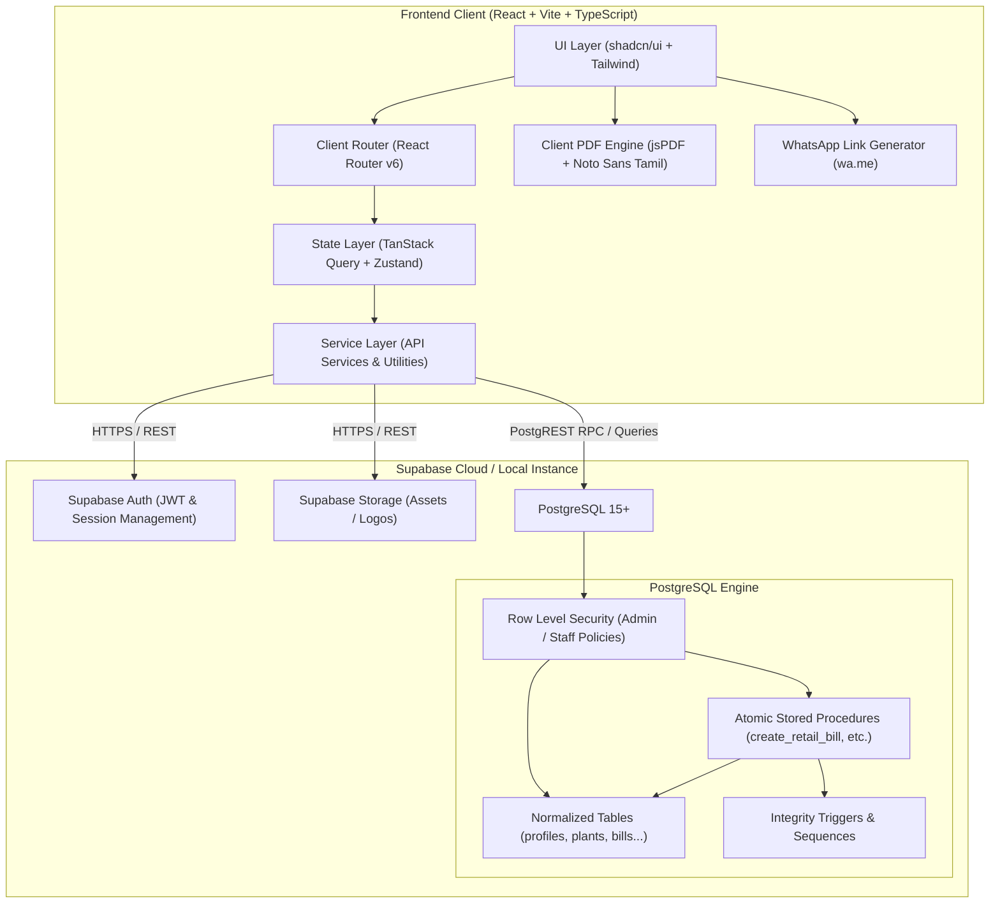
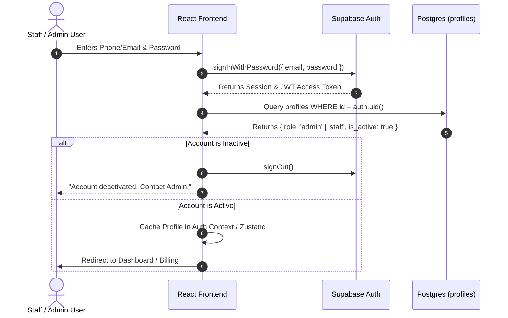
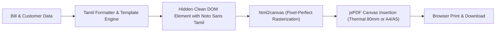

# System Architecture: Kalaiselvi Nursery Garden (KNG)

## 1. High-Level Architecture Overview

The Kalaiselvi Nursery Garden management application is constructed as a modern, decoupled Single Page Application (SPA) backed by a managed Supabase PostgreSQL database. The application adopts a **Client-Heavy, Database-Enforced** architecture: business logic validation happens on the frontend via TypeScript/Zod schemas, while financial integrity, sequence generation, and stock mutations are strictly guarded and executed inside PostgreSQL atomic transactions (RPCs).



---

## 2. Frontend Directory Structure

The frontend application follows a feature-driven, modular architecture designed for maintainability and scalability:

```
src/
├── assets/                       # Static branding, default fallback images, nursery logo
├── components/
│   ├── ui/                       # shadcn/ui base primitives (Button, Input, Dialog, etc.)
│   ├── shared/                   # Cross-feature reusable widgets
│   │   ├── AppHeader.tsx         # Top bar with current date, user profile, notifications
│   │   ├── DesktopSidebar.tsx    # Responsive desktop navigation sidebar
│   │   ├── MobileBottomNav.tsx   # Mobile 5-tab quick touch navigation
│   │   ├── StatusBadge.tsx       # Standardized badges (Paid, Pending, Completed, etc.)
│   │   ├── MetricCard.tsx        # Dashboard KPI metrics card
│   │   ├── ConfirmDialog.tsx     # Generic confirmation modal
│   │   ├── EmptyState.tsx        # Standard zero-state illustration & message
│   │   └── LoadingSpinner.tsx    # Centered and inline loading states
│   └── forms/                    # Form components with React Hook Form + Zod
│       ├── CustomerSelectInput.tsx
│       ├── PlantSearchCombobox.tsx
│       └── CurrencyInput.tsx
├── features/                     # Domain modules
│   ├── auth/                     # Authentication & Session
│   │   ├── components/LoginForm.tsx
│   │   ├── hooks/useAuth.ts
│   │   └── services/authService.ts
│   ├── dashboard/                # Metrics, low stock, upcoming orders
│   │   ├── components/
│   │   │   ├── SalesMetricsGrid.tsx
│   │   │   ├── UpcomingFunctionsList.tsx
│   │   │   ├── LowStockAlertList.tsx
│   │   │   └── RecentTransactionsTable.tsx
│   │   └── hooks/useDashboardMetrics.ts
│   ├── billing/                  # Retail & Function Billing
│   │   ├── components/
│   │   │   ├── RetailBillingForm.tsx
│   │   │   ├── FunctionBookingForm.tsx
│   │   │   ├── FunctionCompletionModal.tsx
│   │   │   ├── BillItemListTable.tsx
│   │   │   ├── BillSummaryCard.tsx
│   │   │   ├── BillReceiptPreview.tsx
│   │   │   └── WhatsAppShareModal.tsx
│   │   ├── hooks/
│   │   │   ├── useRetailBilling.ts
│   │   │   └── useFunctionOrder.ts
│   │   └── services/billingService.ts
│   ├── customers/                # Customer Records & Ledger
│   │   ├── components/
│   │   │   ├── CustomerListTable.tsx
│   │   │   ├── CustomerDetailsView.tsx
│   │   │   ├── CustomerFormModal.tsx
│   │   │   └── CustomerLedgerHistory.tsx
│   │   ├── hooks/useCustomers.ts
│   │   └── services/customerService.ts
│   ├── inventory/                # Plant Inventory & Stock Movements
│   │   ├── components/
│   │   │   ├── PlantListTable.tsx
│   │   │   ├── PlantFormModal.tsx
│   │   │   ├── StockInModal.tsx
│   │   │   ├── StockAdjustmentModal.tsx
│   │   │   └── StockMovementHistory.tsx
│   │   ├── hooks/useInventory.ts
│   │   └── services/inventoryService.ts
│   ├── payments/                 # Payments, Advances, & Balance Collection
│   │   ├── components/
│   │   │   ├── PaymentListTable.tsx
│   │   │   ├── BalanceCollectionModal.tsx
│   │   │   └── PaymentReceiptModal.tsx
│   │   ├── hooks/usePayments.ts
│   │   └── services/paymentService.ts
│   ├── reports/                  # Analytics & Reports
│   │   ├── components/
│   │   │   ├── DailySalesReport.tsx
│   │   │   ├── MonthlyRevenueChart.tsx
│   │   │   ├── PlantWisePerformance.tsx
│   │   │   └── ReceivablesAgingReport.tsx
│   │   └── hooks/useReports.ts
│   └── settings/                 # Business Info, Sequence, Staff Management
│       ├── components/
│       │   ├── BusinessProfileForm.tsx
│       │   ├── BillSequenceConfig.tsx
│       │   └── StaffManagementTable.tsx
│       └── hooks/useSettings.ts
├── layouts/                      # Layout wrappers
│   ├── AppLayout.tsx             # Authenticated shell (Sidebar + Topbar + BottomNav)
│   └── AuthLayout.tsx            # Clean centered login container
├── lib/                          # Core utilities & third-party integrations
│   ├── supabaseClient.ts         # Initialized Supabase client instance
│   ├── pdfGenerator.ts           # jsPDF + Tamil font receipt builder
│   ├── whatsappHelper.ts         # Template builder for WhatsApp URI
│   ├── formatters.ts             # Currency (₹), Date (DD/MM/YYYY), Phone formatters
│   ├── constants.ts              # System defaults, business constants
│   └── utils.ts                  # Tailwind clsx / twMerge helper
├── types/                        # Global TypeScript models & DB types
│   ├── database.types.ts         # Auto-generated / mirror of Supabase schema
│   ├── bill.types.ts             # Domain models for Retail and Function bills
│   ├── customer.types.ts
│   ├── inventory.types.ts
│   └── payment.types.ts
├── App.tsx                       # App entry with Providers & Route definitions
└── main.tsx                      # Vite mounting point
```

---

## 3. Backend Architecture (Supabase & PostgreSQL)

The backend is hosted entirely on Supabase, leveraging PostgreSQL's native capabilities:

1. **Authentication Layer**:
   - `auth.users` manages encrypted passwords, login tokens, and sessions.
   - Synchronized `public.profiles` table contains operational metadata: `full_name`, `phone`, `role` (`admin` or `staff`), and `is_active`.
   - Access tokens (JWTs) carry the user's ID, which Postgres uses to evaluate Row Level Security (RLS) policies.
2. **Database Engine**:
   - PostgreSQL 15+ strictly enforces relational integrity with Foreign Keys and Check Constraints.
   - Financial figures are stored using `NUMERIC(12, 2)` to eliminate floating-point inaccuracies.
   - All critical multi-step operations (such as creating a retail bill with stock decrement, or settling a function order) are encapsulated in PostgreSQL Stored Functions (`SECURITY DEFINER` RPCs). This guarantees:
     - **Atomicity**: The bill, items, stock movement, inventory reduction, and payment record all succeed together or fail together.
     - **Race Condition Prevention**: Stock checks and sequence increments employ row-level locking (`FOR UPDATE`).
3. **Storage Bucket**:
   - A dedicated public/authenticated bucket named `business-assets` stores the nursery logo and receipt signatures.
4. **Row Level Security (RLS)**:
   - Tables are protected by strict RLS policies.
   - Both `admin` and `staff` can read data and issue bills.
   - Sensitive administrative operations (e.g., editing past bills, manual stock adjustments, managing staff accounts, changing business settings) are restricted to `admin` users.

---

## 4. Authentication & Authorization Flow



### Role Matrix

| Capability | Staff Role | Admin Role |
| :--- | :---: | :---: |
| Access Dashboard Metrics | Yes | Yes |
| Create Retail Bills | Yes | Yes |
| Book Function Orders | Yes | Yes |
| Complete Function Orders (Actuals) | Yes | Yes |
| Collect Pending Balance | Yes | Yes |
| Print Bills & Share on WhatsApp | Yes | Yes |
| View Customer Directory | Yes | Yes |
| Perform Stock IN | Yes | Yes |
| Perform Stock Adjustment (Discrepancy) | No | Yes |
| Edit Past Bills or Cancel Bills | No | Yes |
| View Financial Profit & Margins | No | Yes |
| Manage Staff Accounts & Passwords | No | Yes |
| Edit Business Settings & Sequence | No | Yes |

---

## 5. End-to-End Data Flow

### 5.1 Retail Billing Flow
1. Staff selects an existing customer (or enters name, phone, and place for instant auto-registration).
2. Staff adds plants to cart with quantity, unit rate, and optional line discount.
3. System calculates subtotal, bill discount, and net payable in real-time.
4. Staff selects payment mode: Cash or UPI (with optional partial payment).
5. Frontend calls the atomic database function `create_retail_bill(...)`:
   - Checks inventory stock for every plant (`current_stock >= requested_qty`).
   - If stock is insufficient, transaction aborts immediately with a clear error: `"Insufficient stock for [Plant Name]"`.
   - Generates next sequential bill number (e.g., `KNG-RET-2026-0042`).
   - Inserts record into `bills` table (`bill_type = 'RETAIL'`, `stock_deducted = true`).
   - Inserts records into `bill_items`.
   - Decrements `current_stock` in `plants`.
   - Inserts audit rows into `stock_movements`.
   - Inserts payment row into `payments` (if amount > 0).
   - Updates customer's `total_purchases`, `total_paid`, and `outstanding_balance`.
6. Client receives created bill details and displays:
   - Instant Printable Tamil Bill Modal (ready for Thermal / A4 print).
   - Direct WhatsApp button generating pre-formatted Tamil receipt link.

### 5.2 Function Order Lifecycle Flow
1. **Booking Phase**:
   - Customer books an order for a future date (e.g., wedding function 10 days away).
   - Staff inputs Estimated Items (plants, estimated quantities, estimated rates), Advance Payment, and Function Date.
   - Frontend calls `create_function_order(...)`:
     - Creates bill with `status = 'CONFIRMED'`, `bill_type = 'FUNCTION'`, and `stock_deducted = false`.
     - Records advance in `payments`.
     - **Inventory is NOT deducted.**
2. **Post-Event Settlement Phase**:
   - Function concludes. Delivered and returned quantities are finalized.
   - Staff opens Function Order and clicks **"Complete & Generate Final Bill"**.
   - Enters Actual Quantities and Final Rates.
   - Frontend calls `complete_function_order(...)`:
     - Validates current plant stock against actual quantities.
     - Updates `bill_items` with `actual_quantity`.
     - Recalculates final bill `total_amount` and `balance_amount`.
     - Deducts actual quantities from `plants.current_stock`.
     - Creates audit logs in `stock_movements` tagged to this bill.
     - Sets `stock_deducted = true` and `status = 'COMPLETED'`.
     - Records any final settlement payment collected at that time.
   - Outputs final Tamil bill and WhatsApp message.

---

## 6. Tamil Font & PDF Engine Architecture

One of the most frequent points of failure in Indian web applications is corrupt Tamil character rendering in client-side PDFs (rendering question marks or broken ligatures). The system handles this using a robust, multi-layer approach:



1. **Font Support**: Uses Google's `Noto Sans Tamil` font, pre-loaded in the web application.
2. **Dual Print Layout**:
   - **Thermal Receipt (80mm width)**: Ideal for small POS receipt printers used in nursery billing counters.
   - **Standard A5 / A4 Slip**: Professional layout for function orders and institutional clients.
3. **WhatsApp Text Generator**: Independent of PDF rendering; encodes standard Unicode Tamil text directly into the WhatsApp URI (`wa.me/+91...`), ensuring perfect rendering on iOS and Android devices without requiring downloads.
