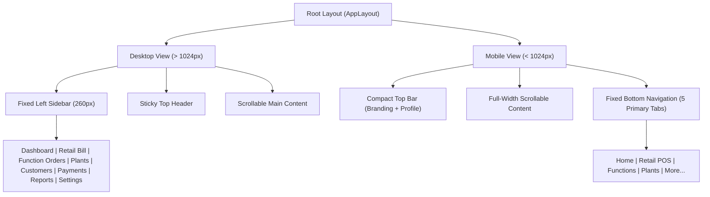

# UI/UX Design System & Screen Specifications: Kalaiselvi Nursery Garden (KNG)

## 1. Visual Identity & Design System

The application is engineered for nursery operations in rural and suburban Tamil Nadu. Ground staff frequently operate on Android smartphones under bright sunlight, requiring high contrast, large touch targets, minimal clutter, and rapid one-thumb workflows.

### 1.1 Color Palette
- **Primary / Brand**: Forest Green (`#166534`, Tailwind `green-800`) – conveys freshness, trust, and nursery agriculture.
- **Primary Dark / Hover**: Deep Forest Green (`#14532d`, Tailwind `green-900`).
- **Accent / Positive**: Leaf Emerald (`#22c55e`, Tailwind `green-500`).
- **Warning / Pending**: Amber Ochre (`#d97706`, Tailwind `amber-600`) – used for pending payments and low stock.
- **Danger / Stock Alert**: Crimson (`#dc2626`, Tailwind `red-600`) – used for zero stock, cancelled orders, and critical alerts.
- **Background**: Soft Mist (`#f8fafc`, Tailwind `slate-50`) – reduces glare on mobile screens.
- **Surface / Card**: Pure White (`#ffffff`) with subtle border (`#e2e8f0`, Tailwind `slate-200`).
- **Text Primary**: Charcoal Navy (`#0f172a`, Tailwind `slate-900`) – maximum legibility.
- **Text Secondary / Labels**: Muted Slate (`#64748b`, Tailwind `slate-500`).

### 1.2 Typography
- **English UI Text**: Inter or system sans-serif (`font-sans`), clean and legible at small sizes.
- **Tamil Text & Receipts**: `Noto Sans Tamil` or system Tamil fonts (`Latha`, `Vijaya`, `Mukta Malar`), ensuring proper rendering of complex ligatures (e.g. `கலைச்செல்வி`, `ரூபாய்`).
- **Monetary / Numerics**: Tabular numbers (`tabular-nums font-mono` for rates, totals, and balances) to ensure aligned decimals.

### 1.3 Touch Targets & Ergonomics
- All interactive buttons and inputs have a minimum touch target size of **48px × 48px** on mobile.
- Form controls feature large, thumb-friendly numeric keypads for quantity and currency fields (`inputMode="decimal"`).
- Keyboard shortcuts for desktop users:
  - `F2` / `Ctrl+B`: Open New Retail Bill
  - `F3`: Focus Plant Search
  - `Esc`: Close open modal/drawer

---

## 2. Navigation Architecture



### Mobile Bottom Navigation (5 Touch Points)
1. **Home** (`Lucide.LayoutDashboard`): Quick view of daily sales, low stock alerts, and quick actions.
2. **Retail Bill** (`Lucide.Receipt`): Fast checkout POS screen.
3. **Functions** (`Lucide.CalendarDays`): Function order booking and event tracking.
4. **Plants** (`Lucide.Sprout`): Quick stock lookups, price checks, and Stock IN.
5. **More** (`Lucide.Menu`): Slide-over drawer with Customers, Payments, Reports, and Settings.

---

## 3. Screen-by-Screen Specifications

### 3.1 Screen 1: Dashboard (`/dashboard`)
*The daily operational hub for nursery owners and staff.*

- **Header KPI Metric Cards (Grid of 4)**:
  1. **Today's Sales**: Total value of invoices generated today (`₹XX,XXX`). Subtitle shows bill count.
  2. **Today's Collection**: Actual money collected today (`₹XX,XXX`). Split indicator: `Cash: ₹X | UPI: ₹Y`.
  3. **Pending Receivables**: Total outstanding balance across all customer accounts (`₹XX,XXX`). Clicking navigates to Pending Receivables report.
  4. **Active Function Orders**: Count of upcoming confirmed orders.
- **Action Bar (Quick Launch Buttons)**:
  - `+ New Retail Bill` (Primary Green, large)
  - `+ Book Function Order` (Secondary Outline)
  - `+ Add Plant Stock` (Muted)
- **Two-Column Responsive Body**:
  - **Left / Top**: **Upcoming Function Orders** (Cards with Function Date, Customer Name, Place, Estimated Plants, Advance Paid, Status Badge).
  - **Right / Bottom**: **Low Stock Warnings** (Table/List of plants with `current_stock <= min_stock_alert`, showing warning badge and quick `Stock IN` button).
- **Recent Transactions Stream**: Last 10 bills generated with customer name, type (Retail/Function), amount, payment status, and 1-click WhatsApp share button.

---

### 3.2 Screen 2: Retail Billing POS (`/billing/retail`)
*Optimized for rapid checkout with high throughput.*

- **Layout (Desktop: 2 Columns / Mobile: Stacked Tabs or Drawer)**:
  - **Left Section (Plant Picker)**:
    - Search Bar with instant debounce: search by plant English name, Tamil name, or category filter pills (Flowering, Fruit, Timber, Indoor, etc.).
    - Quick Plant Cards: Shows Plant Name, Tamil Subtitle, Selling Rate (`₹50/pot`), Available Stock (`Stock: 120`), and `+ Add` button.
    - If stock = 0, card is disabled with badge: `"Out of Stock"`.
  - **Right Section (Bill Cart & Checkout)**:
    - **Customer Selector**: Search existing customer by phone number or name with auto-complete. If not found, inline `+ Add Customer` button displays a lightweight modal (Name, Phone, Place).
    - **Cart Items Table**:
      - Plant Name & Category
      - Quantity (with `[-]` `[input]` `[+]` quick increment buttons)
      - Unit Rate (editable if Admin, locked if Staff)
      - Line Total (`Qty * Rate`)
      - Remove Item button (`Trash2`)
    - **Bill Calculation Box**:
      - Subtotal: `₹XXX`
      - Discount (INR): Numeric input with automatic net total calculation.
      - **Grand Total Payable**: Large green text (`₹XXX`).
    - **Payment Details**:
      - Payment Mode Toggle: `[ Cash ]` or `[ UPI ]`.
      - Paid Amount Input: Defaults to Grand Total. If user enters less, an orange warning displays: `"Pending Balance: ₹XXX will be credited to customer account"`.
      - Transaction Reference (Optional UPI UTR / Reference).
    - **Checkout Actions**:
      - **[ Finalize Bill & Print ]** (Primary Green Button): Calls `create_retail_bill` RPC.
      - On success, opens the **Bill Receipt Modal** with instant Tamil print preview and a prominent green **[ Send WhatsApp Bill ]** button.

---

### 3.3 Screen 3: Function Order Booking (`/billing/function/new`)
*Designed for advance event reservations without touching inventory.*

- **Section 1: Customer & Event Details**:
  - Customer Name, WhatsApp Phone Number, Event Location / Place.
  - Function Date & Time Picker (e.g. `24/11/2026 09:00 AM`).
  - Function Description / Event Type (e.g., `Wedding Reception / Temple Festival / Housewarming`).
- **Section 2: Estimated Plants Required**:
  - Add line items: Plant selection, **Estimated Quantity**, **Agreed Rate**, and Calculated Estimated Total.
  - Informational Banner:
    > [!NOTE]
    > **Inventory Notice**: Booking an order saves estimated quantities for planning purposes. **Stock is NOT deducted** until the event completes and the final bill is verified.
- **Section 3: Advance Payment & Booking Confirmation**:
  - Estimated Total: `₹XX,XXX`
  - Advance Amount Paid: Input field (`₹X,XXX`).
  - Advance Payment Mode: `[ Cash ]` or `[ UPI ]`.
  - Estimated Balance Remaining: `₹XX,XXX`.
  - Billed By: Automatically shows logged-in Staff name and phone.
- **Action**:
  - **[ Confirm & Book Order ]**: Calls `create_function_order` RPC.
  - Generates Function Order Slip with status `CONFIRMED` and outputs the WhatsApp advance confirmation message.

---

### 3.4 Screen 4: Function Order Detail & Completion (`/billing/function/:id`)
*Where post-event reconciliation occurs.*

- **Order Status Header**: Bill Number, Status Badge (`CONFIRMED`), Function Date, Customer Contact.
- **Reconciliation Comparison Table**:
  - Plant Name
  - Estimated Quantity (Quoted at booking)
  - **Actual Delivered / Used Quantity** (Editable input field)
  - Unit Rate (Editable if negotiated)
  - Line Total (`Actual Qty * Rate`)
  - Difference / Variance (`+ / - Qty`)
- **Final Financial Calculation**:
  - Revised Final Subtotal
  - Final Discount
  - **Final Total Amount**
  - Less: Advance Paid Previously (`₹X,XXX`)
  - **Remaining Balance Due**: `₹X,XXX`
- **Final Settlement Action**:
  - Payment Mode for balance collection (`Cash` / `UPI`).
  - Additional Payment Collected Now: Input field.
  - Remaining Unpaid Balance (if any): Transferred to customer ledger.
- **Complete Order Trigger**:
  - **[ Settle Order & Deduct Stock ]** button with confirmation dialog.
  - Calls `complete_function_order` RPC.
  - Deducts actual plant stock from inventory, updates status to `COMPLETED`, logs movement audit, and triggers the Final Tamil Invoice.

---

### 3.5 Screen 5: Bill Receipt View & WhatsApp Share Modal
*Standardized customer-facing bill matching business specifications.*

- **Thermal 80mm Print Preview & Standard A4/A5 View**:
  ```
  🌱 KALAISELVI NURSERY GARDEN
  கலைச்செல்வி நர்சரி கார்டன்
  📍 Mailam Road, Kutteripattu – 604304
  📞 9488782488 / 8531859560
  ━━━━━━━━━━━━━━━━━━━━━━━━━━━━━━
  Bill No: KNG-RET-2026-00042
  Date: 16/11/2026  07:30 PM
  Customer: Murugan
  Place: Tindivanam
  ━━━━━━━━━━━━━━━━━━━━━━━━━━━━━━
  Plant Details:
  1. Malli / Jasmine x 10 @ ₹40.00 = ₹400.00
  2. Rose Hybrid    x 5  @ ₹60.00 = ₹300.00
  ━━━━━━━━━━━━━━━━━━━━━━━━━━━━━━
  Subtotal:              ₹700.00
  Discount:               ₹50.00
  Total Amount:          ₹650.00
  Amount Paid:           ₹650.00 (UPI)
  Balance Due:             ₹0.00
  ━━━━━━━━━━━━━━━━━━━━━━━━━━━━━━
  Billed By: Ramesh (Staff)
  📞 9488782488
  
  🙏 எங்களை தேர்ந்தெடுத்ததற்கு நன்றி! மீண்டும் வருக! 🌱
  ```
- **WhatsApp Share Action**:
  - Prominent Green Button: **[ Share on WhatsApp ]**.
  - Formats text dynamically using the exact customer specification:
    ```
    🌱 *KALAISELVI NURSERY GARDEN*

    📍 Mailam Road, Kutteripattu – 604304

    ━━━━━━━━━━━━━━

    👤 *Customer Name:* Murugan
    📍 *Place:* Tindivanam
    📅 *Date:* 16/11/2026

    🌿 *Order Details*
    - Plant Quantity: 15
    - Rate: ₹650.00
    - Total Amount: ₹650.00

    💰 *Payment Details*
    - Advance Paid: ₹650.00
    - Balance Amount: ₹0.00

    ━━━━━━━━━━━━━━

    🧾 *Billed By:* Ramesh
    📞 9488782488

    🙏 Thank you for choosing Kalaiselvi Nursery Garden! 🌱
    ```
  - Deep-link target: `https://wa.me/919876543210?text=...` opens native WhatsApp app on mobile or WhatsApp Web on desktop.

---

### 3.6 Screen 6: Customers Directory (`/customers`)
- **Customer List Table**:
  - Name & WhatsApp Phone
  - Place / Town
  - Total Purchases (`₹XX,XXX`)
  - Total Paid (`₹XX,XXX`)
  - Outstanding Balance (`₹XX,XXX` highlighted in red if > 0)
  - Quick Actions: `[ Collect Balance ]`, `[ View Ledger ]`
- **Customer Detail / Ledger Drawer**:
  - Full contact info and notes.
  - Lifetime statistics card.
  - Tab 1: **Orders History** (all retail bills and function orders with date, bill number, amount, balance, status).
  - Tab 2: **Payment History** (audit log of every advance, counter payment, and settlement with receipt numbers and staff who collected it).
  - Floating Action: `[ Record Balance Payment ]` button.

---

### 3.7 Screen 7: Plant Inventory (`/inventory`)
- **Controls**: Category Filter Pills, Search Bar, Toggle `"Low Stock Only"`, `+ Add Plant` (Admin only).
- **Inventory Table**:
  - Plant Name (English + Tamil)
  - Category Badge
  - Selling Rate (`₹`)
  - Current Stock (with Green / Amber / Red indicator based on `min_stock_alert`)
  - Status (`Active` / `Inactive`)
  - Row Actions: `[ Stock IN ]`, `[ Adjust Stock ]` (Admin), `[ History ]`.
- **Stock IN Modal**:
  - Plant selector, Quantity to add, Source/Supplier remarks.
  - Increases `current_stock` and writes to `stock_movements`.
- **Stock Adjustment Modal (Admin Only)**:
  - Displays Current Stock.
  - Input New Verified Physical Stock.
  - Calculates Discrepancy (`+/- Qty`).
  - Mandatory Audit Reason dropdown: `Damaged / Died`, `Count Error`, `Customer Return`, `Personal Use`.
  - Atomically updates stock and writes to `stock_movements`.
- **Stock Movement History View**:
  - Filterable by plant. Shows Date, Movement Type badge, Delta Qty (`+50` in green, `-10` in red), Resulting Stock, Reference Bill, and Staff.

---

### 3.8 Screen 8: Payments & Collections (`/payments`)
- **Summary Cards**: Today's Collections (`₹`), Total Outstanding Receivables across all customers (`₹`).
- **Payment Transaction Table**:
  - Receipt No (`PAY-20261116-001`)
  - Date & Time
  - Customer Name & Place
  - Bill Reference Number
  - Amount Paid (`₹`)
  - Payment Mode (`Cash` / `UPI`)
  - Type (`Retail` / `Advance` / `Balance Settlement`)
  - Received By (Staff name)
  - `[ Print Receipt ]` button
- **Balance Collection Modal**:
  - Search customer with outstanding dues.
  - Select unpaid bill(s).
  - Input collection amount and mode (`Cash` / `UPI`).
  - Calls `record_balance_payment` RPC.
  - Updates bill balance, customer balance, and issues receipt.

---

### 3.9 Screen 9: Reports & Analytics (`/reports`)
- **Date Range Selector**: `Today`, `This Week`, `This Month`, `Custom Range`.
- **Report Modules**:
  1. **Daily Sales & Collection Report**: Day-by-day matrix of sales generated vs cash/UPI collected.
  2. **Retail vs Function Comparison**: Pie chart / breakdown showing revenue distribution.
  3. **Plant Sales Velocity**: Top-selling plants by quantity and revenue.
  4. **Receivables Aging List**: Breakdown of customers with pending balances (> 30 days, > 60 days).
- **Export Capabilities**: Clean PDF print sheet and CSV download for Excel records.

---

### 3.10 Screen 10: Settings & Staff (`/settings`)
- **Business Profile Tab**:
  - Business Name (English & Tamil)
  - Address
  - Contact Phone Numbers (3 fields)
  - Bill Footer Notes (Tamil & English)
  - Logo Upload to Supabase Storage with instant preview.
- **Bill Sequence Configuration Tab**:
  - Retail prefix (`KNG-RET`) & Next sequence number.
  - Function prefix (`KNG-FNC`) & Next sequence number.
- **Staff Management Tab (Admin Only)**:
  - List of staff accounts: Full Name, Phone, Role (`Admin` / `Staff`), Status (`Active` / `Inactive`).
  - `+ Add Staff Account` modal: creates login credentials in Supabase Auth and registers profile.
  - Toggle staff active/inactive switch (instantly revokes access for departed employees).

---

## 4. UI States Specification

| State | Visual Treatment | Example Scenario |
| :--- | :--- | :--- |
| **Loading State** | Skeleton loaders matching card/table layouts + subtle green pulse. | Fetching plant inventory, loading dashboard analytics. |
| **Empty State** | Centered SVG illustration + friendly explanatory text + primary action button. | "No function orders scheduled this week. [ Book Function Order ]" |
| **Error State** | Non-intrusive red alert banner with retry button; inline field errors in forms. | "Failed to connect to database. [ Retry ]" |
| **Success State** | Green animated checkmark dialog + immediate actionable options (Print, WhatsApp, New Bill). | "Bill KNG-RET-2026-0042 created successfully!" |
| **Warning State** | Amber badge / dialog for irreversible financial or stock actions. | "Plant 'Red Rose' will drop to 2 pots after this sale." |
